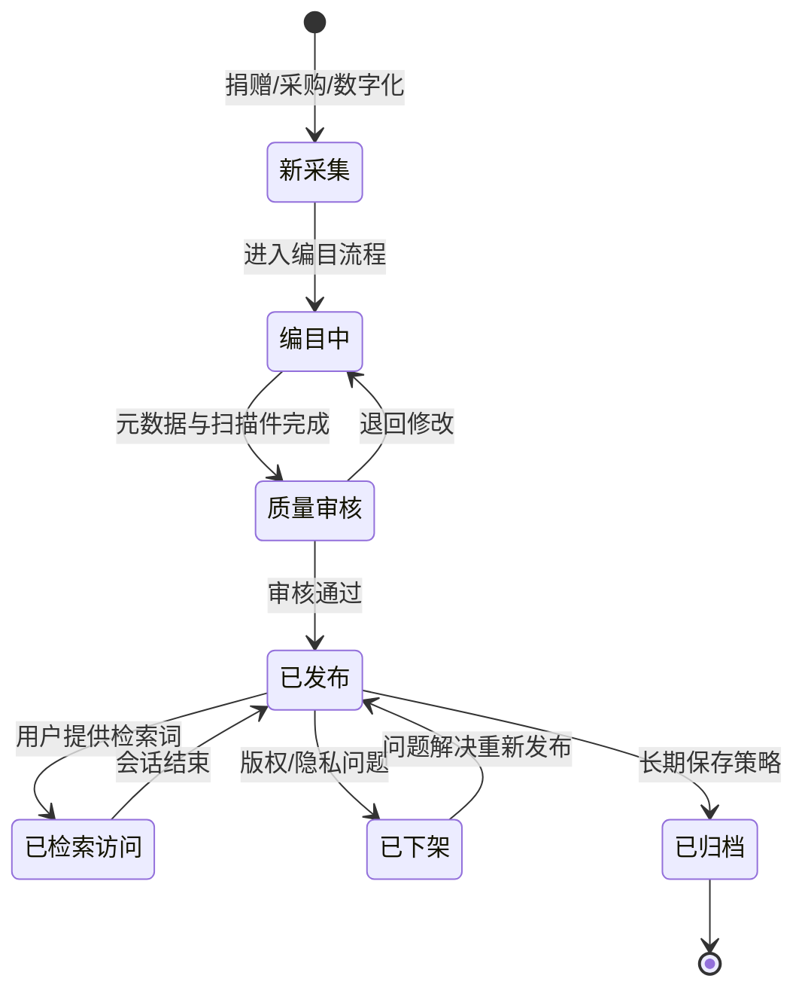
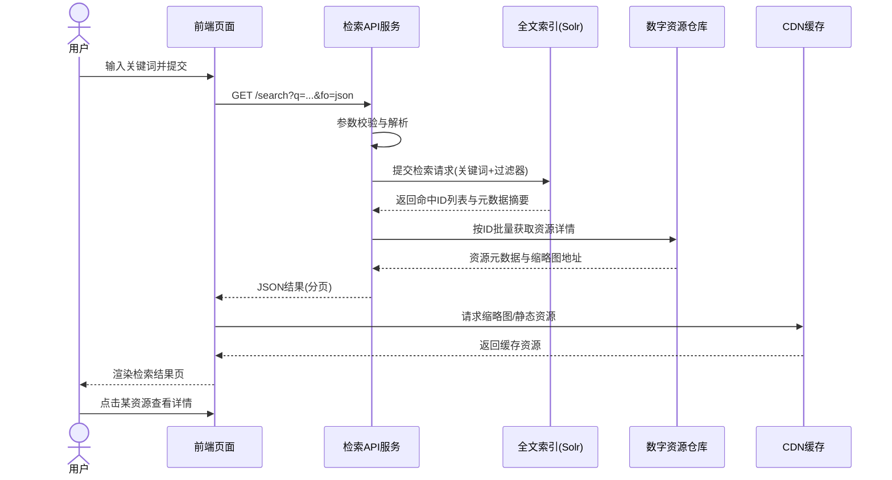
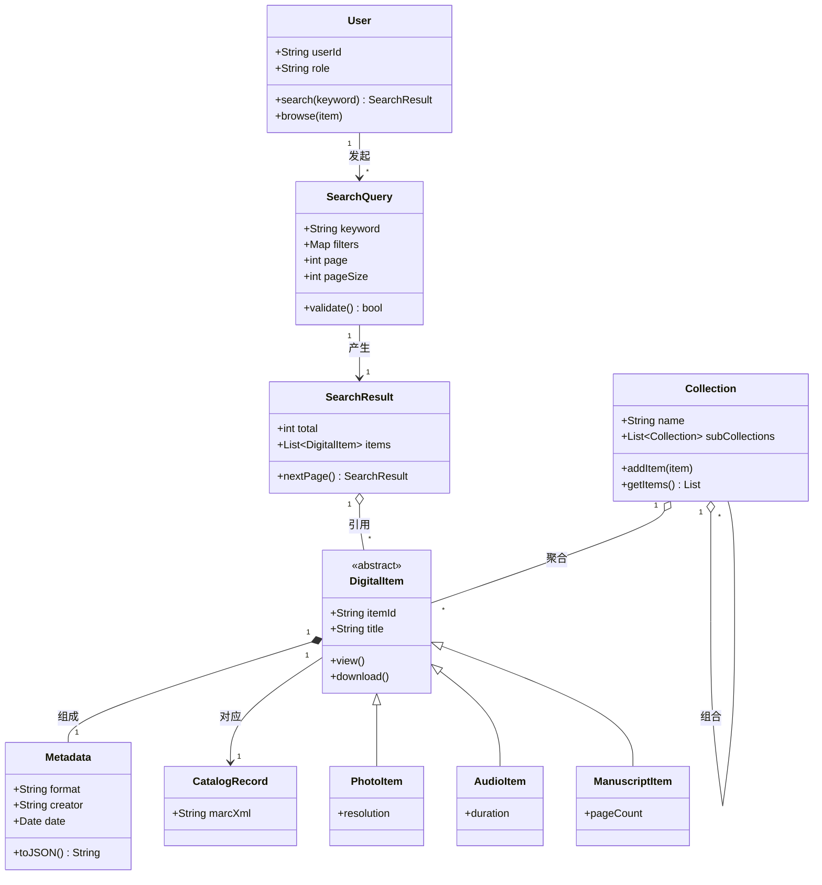
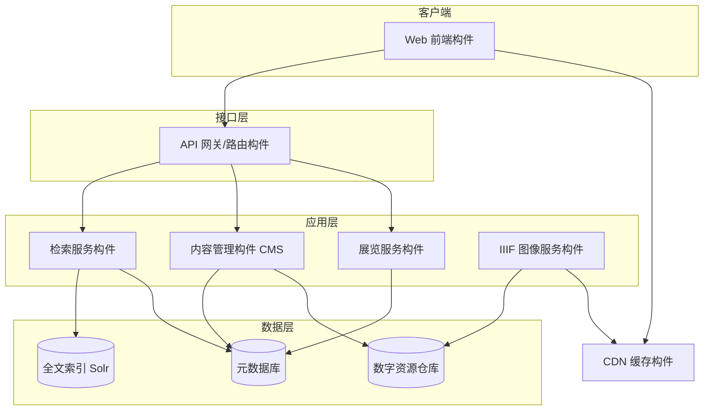

#


---

## 一、领域对象建模

### 1.1 核心领域对象识别

从业务需求出发，采用名词分析法识别出以下核心领域对象：

| 领域对象  | 英文            | 说明                                |
| ----- | ------------- | --------------------------------- |
| 用户    | User          | 访客、研究者、教育者等，具有检索、浏览、下载等行为         |
| 藏品集   | Collection    | 按主题组织的资源集合，可包含子集合（树形结构）           |
| 数字资源项 | DigitalItem   | 照片、手稿、地图、音视频、报纸等数字化对象             |
| 元数据   | Metadata      | 描述资源的结构化数据（Dublin Core / MODS 标准） |
| 检索请求  | SearchQuery   | 用户提交的关键词、过滤条件、分页参数                |
| 检索结果  | SearchResult  | 命中资源列表及总数                         |
| 编目记录  | CatalogRecord | 资源的编目信息，供 MARC 检索系统使用             |
| 展览    | Exhibition    | 策展类内容，聚合若干 DigitalItem            |

### 1.2 领域对象关系

- 一个 Collection 聚合多个 DigitalItem（1..*），且 Collection 可嵌套子 Collection（组合关系）；
- 每个 DigitalItem 关联一份 Metadata（1..1）；
- User 发起 SearchQuery，系统返回 SearchResult，SearchResult 引用若干 DigitalItem；
- Exhibition 引用（非拥有）多个 DigitalItem，体现聚合与引用的区分。

### 1.3 建模原则对照

- **抽象与封装**：DigitalItem 屏蔽了照片/音频/地图等异构资源的内部差异，对外统一暴露"可检索、可查看、可下载"的接口；
- **单一职责原则（SRP）**：检索、编目、展示、下载各由独立对象/服务承担；
- **开闭原则（OCP）**：新增资源类型（如新增"口述历史音频"）只需扩展子类与注册解析器，不修改检索框架；
- **高内聚低耦合**：元数据管理与图像呈现分离，通过接口交互。

---

## 二、系统应用架构设计

### 2.1 总体架构：B/S 三层架构（分层风格 + 以数据为中心的仓库风格）

```
┌─────────────────────────────────────────────┐
│  表现层：响应式 Web 前端（Drupal 渲染 + JS 交互） │
├─────────────────────────────────────────────┤
│  应用层：检索服务 │ 内容管理 │ 用户服务 │ 展览服务  │
├─────────────────────────────────────────────┤
│  数据层：全文索引(Solr) │ 元数据库 │ 数字资源仓库   │
└─────────────────────────────────────────────┘
```

- **表现层**：浏览器端页面，负责布局、交互与结果展示；
- **应用层**：封装业务逻辑——检索编排、权限控制、结果聚合；
- **数据层**：海量数字化资源以"仓库（Repository）"形式集中管理，各服务围绕仓库读写，典型的**以数据为中心**架构。

### 2.2 关键架构决策

1. **检索与存储分离**：全文索引（Solr）与对象存储分离，检索流量与资源下载流量互不影响；
2. **CDN + 缓存层**：数字化资源访问量大、读多写少，采用内容分发网络加速静态资源；
3. **IIIF 图像服务**：图像查看独立成服务（International Image Interoperability Framework），支持缩放、对比、切图；
4. **API 优先**：对外的检索、资源元数据均可通过 JSON API 获取，供第三方复用。

---

## 三、接口层设计

### 3.1 接口形式

- **RESTful HTTP API**：
  - 检索：`GET /search/?q=关键词&fo=json`
  - 资源详情：`GET /resource/{id}/?fo=json`
- **IIIF Image API**：`GET /image/{id}/{region}/{size}/.jpg`
- **网页端 JSON-LD**：页面内嵌结构化元数据，利于机器解析与搜索引擎收录。

### 3.2 接口设计原则对照

| 课程原则         | 网站中的体现                                     |
| ------------ | ------------------------------------------ |
| 统一接口、资源化 URI | 一切皆资源（collection/item/search），URI 即标识      |
| 无状态          | 每个请求携带全部参数（关键词、分页页码），服务端不保存会话状态            |
| 可缓存          | 静态资源与结果页通过 CDN/ETag 缓存                     |
| 分页与流量控制      | 检索结果分页返回，避免大结果集一次性传输                       |
| 版本与向后兼容      | 参数化输出（`fo=json` / `fo=jsonld`），同一 URI 多种表示 |
| 标准化协议        | 采用 IIIF、JSON-LD、Dublin Core 等开放标准，保证互操作性   |

---

## 四、状态图（数字资源项的生命周期）



状态迁移体现了**受控的数字化资源生命周期管理**：只有"已发布"状态的对象才对公众可见，审核不通过可回退，符合内容型系统的状态机设计要求。

---

## 五、交互图（用户检索资源的顺序图）



交互体现了接口层"**前端只与 API 通信、服务层只与索引/仓库通信**"的分层调用约束，各层职责清晰、依赖单向。

---

## 六、类图



类图要点：`DigitalItem` 抽象类 + 三类子体现实**多态与开闭原则**；Collection 自包含构成**组合（Composite）模式**的结构基础。

---

## 七、构件图



构件间通过**接口（REST/IIIF）**&#x8FDE;接，而非直接访问对方内部数据，符合课程中"构件通过接口提供服务、实现可替换性"的要求——例如全文索引由 Solr 替换为 Elasticsearch 时，只需检索构件适配新的接口实现，上层构件不受影响。

---

## 八、软件架构体系总结

| 维度   | 结论                                                                           |
| ---- | ---------------------------------------------------------------------------- |
| 逻辑架构 | 分层架构（表现层 / 应用层 / 数据层）+ 面向对象建模                                                |
| 物理架构 | B/S 三层，浏览器—Web 服务—数据库/仓库，CDN 边缘分发                                            |
| 架构风格 | ① 分层风格（主）② 以数据为中心的仓库风格（数字资源仓库）③ 管道-过滤器风格（采集→数字化→编目→发布流水线）④ REST 风格（对外接口）     |
| 演进趋势 | 单体 CMS（Drupal）+ 独立检索服务，正走向"API 优先 / 微服务化"的混合架构                               |
| 质量属性 | 可用性（CDN、缓存）、可修改性（构件接口化）、可互操作性（IIIF、JSON-LD、Dublin Core 开放标准）、性能（读多写少场景以缓存优先） |

---

## 九、设计模式分析

| 设计模式               | 应用位置                                   | 作用                                |
| ------------------ | -------------------------------------- | --------------------------------- |
| **MVC**            | 前端页面与 Drupal CMS                       | 模型（资源/元数据）、视图（页面模板）、控制器（路由）分离     |
| **组合模式 Composite** | Collection ↔ 子 Collection ↔ Item 的树形结构 | 统一处理集合与单项的遍历与展示                   |
| **门面模式 Facade**    | API 网关                                 | 将索引、仓库、元数据库等多个子系统封装为一组简洁的 REST 接口 |
| **代理模式 Proxy**     | CDN 缓存 / IIIF 图像服务                     | 对远程大图像的按需、按尺寸访问（虚拟代理 + 缓存代理）      |
| **工厂模式 Factory**   | 资源解析与查看器创建                             | 根据资源类型（照片/音频/手稿）动态创建对应解析器或查看器     |
| **迭代器模式 Iterator** | 检索结果分页                                 | 统一遍历结果集，`nextPage()` 逐页获取         |
| **观察者模式 Observer** | 订阅更新、新藏品上线通知                           | 资源状态变化时通知订阅者                      |
| **单例模式 Singleton** | 数据库连接池、全局配置                            | 应用层共享唯一实例，节省资源                    |
| **策略模式 Strategy**  | 检索排序策略（相关度/年份/格式过滤）                    | 排序与过滤算法可切换，互不影响                   |

---

##
