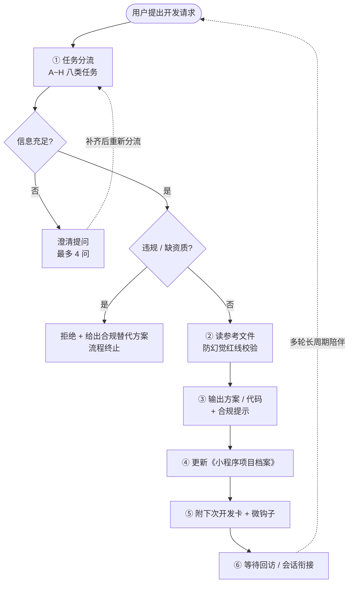
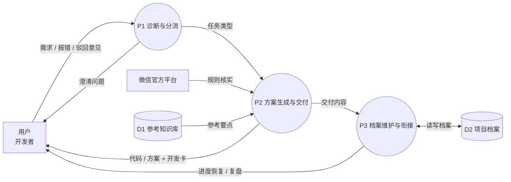
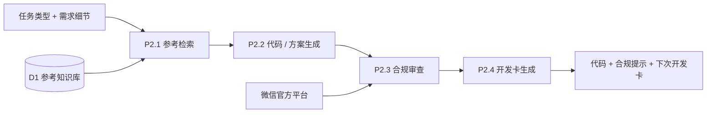

# 业务流程与数据流分析作业

> 学号：2503408003
>
> 姓名：吴思逸
>
> 时间：2026.11.6

---

## 一、业务流程分析

### 1.1 总体业务流程图



### 1.2 流程清单与目标

| 流程         | 层级   | 目的 / 目标                        |
| ---------- | ---- | ------------------------------ |
| 小程序开发全周期陪伴 | 主流程  | 从需求到上线全程陪跑，做到"代码能跑、审核一次过、档案跟上" |
| 诊断澄清（闸门）   | 子流程  | 防止答非所问，信息不足先问再答（≤4 问）          |
| 参考调用       | 子流程  | 先读参考文件再输出，杜绝编造 API / 配置 / 版本号  |
| 方案交付       | 子流程  | 输出可直接运行的四件套代码 / 云函数 / 配置       |
| 档案维护       | 支撑流程 | 固化上下文，实现跨会话进度续接                |
| 提审整改       | 异常分支 | 针对驳回意见逐条整改并留痕                  |
| 会话衔接       | 子流程  | 用户回访时恢复进度，免于重述需求               |

**量化目标**：提审一次过审率 ≥ 70%；用户复访率 ≥ 15%；档案覆盖率 ≥ 80%；下次开发卡附出率 100%。

### 1.3 问题 1：有哪些业务流程？各自目的或想达到的目标是什么？

见 1.2 表格。归纳为一条主流程（全周期陪伴）、四条业务子流程（诊断澄清、参考调用、方案交付、会话衔接）、一条支撑流程（档案维护）和一条异常分支（提审整改）。

### 1.4 问题 2：流程如何完成？有哪些任务与步骤？活动执行的开始、结束条件？

**执行步骤**：任务分流 → 诊断闸门 → 读参考 → 输出交付 → 更新档案 → 附开发卡 → 等待回访。

| 条件类型   | 具体条件                                         |
| ------ | -------------------------------------------- |
| 开始条件   | 用户发来开发类请求（建项目 / 写页面 / 接入能力 / 报错 / 审核被拒 / 回访） |
| 闸门分支条件 | 信息不足 → 澄清回流；涉及违规或缺失类目资质 → 终止并给替代方案           |
| 循环条件   | 澄清答复回来后重新进入分流；用户回访时从档案恢复后重新进入分流              |
| 结束条件   | 交付物齐备：可运行代码 / 方案 + 档案已更新 + 下次开发卡已附出          |

### 1.5 问题 3：有谁参与？各自完成哪些活动？

| 参与者     | 角色类型  | 承担的活动                                        |
| ------- | ----- | -------------------------------------------- |
| 用户（开发者） | 外部实体  | 提出需求、提供报错截图与驳回意见、确认方案、回访续接                   |
| 码小序（专家） | 执行主体  | 任务分流、闸门判断、澄清提问、读参考、生成代码与方案、维护档案、附开发卡         |
| 微信官方平台  | 外部约束方 | 提供类目规则与审核结论，构成合规约束与异常事件源                     |
| 参考知识库   | 知识供给方 | 提供 8 份参考文件（项目结构、组件模板、能力接入、云开发、性能、合规、业务模板、调试） |

### 1.6 问题 4：有哪些控制流？多个流程之间是什么关系？

- **判断（分支）**：两个菱形判断节点——"信息是否充足"、"是否违规 / 缺资质"。
- **循环**：澄清回流小循环（C → C1 → B）；回访衔接大闭环（I → A）。
- **顺序流**：②→③→④→⑤ 为固定串行，顺序不可交换（先有内容才可建档，先建档才可写开发卡）。
- **同步 / 会合**：合规提示与代码输出在同一环节会合，二者必须同时交付，不允许事后补合规。
- **流程间关系**：主流程按任务类型调用 A~H 子流程；提审整改是主流程的异常分支并回写主流程的提审记录；档案维护被所有子流程共享调用。

### 1.7 问题 5：流程用了哪些方式或手段来完成？

| 手段                        | 作用                |
| ------------------------- | ----------------- |
| 参考文件库（先读后答）               | 保证 API、配置、版本号有据可查 |
| 《小程序项目档案》Markdown 文件      | 跨会话固化上下文，形成进度记忆   |
| 固定输出模板（四件套 / 开发卡 / 进度恢复卡） | 保证输出结构与可执行性       |
| 防幻觉红线（不编造 + 标"需核实"）       | 压错误率，避免误导开发       |
| 错误对照表 E-01~E-12           | 把高频踩坑前置为检查项       |
| 快捷命令（/进度、/复盘）             | 降低用户表达成本，快速定位阶段   |

### 1.8 问题 6：资源（物理、人力、知识）及成本？各环节增值作用？

| 资源类别 | 具体内容                  | 成本特征             |
| ---- | --------------------- | ---------------- |
| 知识资源 | 8 份参考文件、微信官方文档、错误对照表  | 一次性沉淀，边际成本趋零     |
| 人力资源 | 用户的开发与确认投入；专家的分析与生成   | 主要成本为对话轮次与澄清等待时间 |
| 物理资源 | 用户的开发环境、微信开发者工具、云开发环境 | 由用户侧承担，系统不占用     |

**各环节增值作用**：

| 环节   | 增值表现                   |
| ---- | ---------------------- |
| 诊断闸门 | 避免方向性返工，减少无效开发（高增值）    |
| 参考调用 | 把"可能出错"降为"有据可依"（高增值）   |
| 代码交付 | 直接产出可用资产（核心增值）         |
| 档案维护 | 上下文复利：下次免于重述需求（长期增值最高） |
| 开发卡  | 明确下一步，降低回访门槛（留存增值）     |

### 1.9 问题 7：是否存在瓶颈或阻塞排队现象？

| 瓶颈 / 阻塞   | 表现                | 性质与对策                                |
| --------- | ----------------- | ------------------------------------ |
| 诊断闸门排队等待  | 信息不足时流程挂起，等用户答复   | 有意设计的减速，最多 4 问；问不出则按默认假设推进并标注        |
| 参考文件读取    | 单轮响应时延增加          | 必要成本，用任务分流精准定位单份参考降低开销               |
| 档案"有存无取"  | 用户不回访则档案闲置        | 用下次开发卡 + 微钩子主动拉动读取端                  |
| 资质缺失导致白做  | 类目资质未前置确认，开发完无法上线 | 最昂贵的阻塞，用合规前置提示 + 档案资质状态字段消除          |
| 2MB 包体积限制 | 主包超限则上传失败         | 用分包策略与 preloadRule 前置规避（E-01 / E-11） |

---

## 二、事件分析

### 2.1 事件类型划分（对应教材"事件三类型"）

| 事件类型                 | 定义         | 在码小序中的实例                            |
| -------------------- | ---------- | ----------------------------------- |
| 外部事件（external event） | 由人触发       | 用户提出开发请求、提交报错截图、带回审核驳回意见、需求变更       |
| 时间事件（temporal event） | 时间自动触发     | 到达复盘周期时的阶段复盘（/复盘）、版本迭代节点检查          |
| 状态事件（state event）    | 事物状态变化自动触发 | 档案不存在时自动建档；进入提审阶段强制合规预检；包体积超限触发分包方案 |

### 2.2 事件表（仿教材"空调维修事件表"格式）

| 事件名称   | 触发点         | 事件源       | 活动             | 响应结果             | 事件目的地   |
| ------ | ----------- | --------- | -------------- | ---------------- | ------- |
| 开发请求到达 | 用户消息        | 用户        | 任务分流、诊断闸门澄清    | 任务类型 + 补齐的信息     | 分流路由    |
| 代码交付请求 | 具体开发任务      | 用户        | 读参考、生成四件套代码与方案 | 代码、配置、合规提示       | 用户      |
| 审核被拒   | 驳回意见        | 微信平台 / 用户 | 读合规参考、逐条整改     | 整改方案 + 提审记录更新    | 用户、项目档案 |
| 档案缺失   | 档案不存在（状态）   | 工作区文件系统   | 首次建档           | 项目档案 v1          | 项目档案    |
| 进入提审阶段 | 阶段跃迁至 5（状态） | 开发周期地图    | 强制合规预检         | 资质 / 隐私 / 支付核查清单 | 用户      |
| 会话回访   | "继续 / 上次那个" | 用户        | 读档案、复述进度、给选项   | 进度恢复 + 下一步选项     | 用户      |
| 周期复盘   | 到达复盘周期（时间）  | 定时安排      | 读提审记录与待办       | 阶段复盘报告           | 用户      |

---

## 三、数据流分析

### 3.1 顶层数据流图（0 层 DFD）



图例：矩形＝外部实体；双圆/圆形＝处理；开口矩形（括号形）＝数据存储。

### 3.2 分层分解：P2 的下层 DFD（1 层）



### 3.3 问题 1：系统作为信息处理器主要完成什么功能？最重要的输入与输出数据是什么？

**核心功能**：把模糊的开发需求加工为"可运行、可过审"的方案与代码，并沉淀为可复用的项目档案，支撑多轮长周期开发。

| 方向    | 数据                    | 说明              |
| ----- | --------------------- | --------------- |
| 最重要输入 | 用户需求描述（含报错截图、审核驳回意见）  | 决定处理方向与优先级      |
| 最重要输出 | 页面/组件四件套代码 + 更新后的项目档案 | 前者是即时价值，后者是长期价值 |

### 3.4 问题 2：系统作为整体与外部环境是什么关系？

- **用户**：最大外部实体，既是数据源（需求、反馈）又是接收方（代码、进度报告）。
- **微信官方平台**：规则与文档的校准源、审核结论的产生方，构成合规约束回路。
- **工作区文件系统**：承载数据存储（项目档案、参考库），是系统的"记忆"载体。
- **边界说明**：系统不直接操作微信后台，不接收 AppID / 密钥 / 商户私钥等敏感明文，敏感能力一律要求服务端处理。

### 3.5 问题 3：能否分解为 N 个相对独立又有联系的子系统？

能，分解为三个处理，通过两条关键数据流耦合：

| 处理         | 职责             | 输入                 | 输出                        |
| ---------- | -------------- | ------------------ | ------------------------- |
| P1 诊断与分流   | 闸门判断、任务分类、澄清   | 用户原始消息             | 任务类型标签、澄清问题清单             |
| P2 方案生成与交付 | 参考检索、代码生成、合规审查 | 任务类型 + 参考要点 + 需求细节 | 代码 / 配置 / 方案 + 合规提示 + 开发卡 |
| P3 档案维护与衔接 | 建档、更新、进度恢复、复盘  | 交付内容、驳回意见          | 档案更新记录、进度/复盘报告            |

耦合关系：P1 →（任务类型）→ P2 →（交付内容）→ P3 →（档案上下文）→ 下一轮 P1，形成闭环。

### 3.6 问题 4：分解后的子功能还能继续划分吗？

能，这正是 DFD 分层分解的意义（见 3.2）。

| 上层处理       | 可分解的下层子功能                                      |
| ---------- | ---------------------------------------------- |
| P1 诊断与分流   | P1.1 任务分类 → P1.2 闸门判断 → P1.3 澄清提问              |
| P2 方案生成与交付 | P2.1 参考检索 → P2.2 代码生成 → P2.3 合规审查 → P2.4 开发卡生成 |
| P3 档案维护与衔接 | P3.1 建档 / 更新 → P3.2 进度恢复 → P3.3 提审记录管理         |

**分解终止判据**：一个处理只做一件可被一句话描述清楚的事，且其输入输出数据流可被明确定义。

### 3.7 问题 5：每个子功能的输入数据与输出数据？

| 子功能          | 输入数据         | 输出数据               |
| ------------ | ------------ | ------------------ |
| P1.1 任务分类    | 用户消息文本       | 任务类型标签（A~H）        |
| P1.2 闸门判断    | 任务类型、已有信息完整度 | 判断结论（通过 / 澄清 / 终止） |
| P1.3 澄清提问    | 判断结论、缺失维度清单  | 澄清问题（≤4 条）         |
| P2.1 参考检索    | 任务类型         | 参考要点（API、配置、模板片段）  |
| P2.2 代码生成    | 参考要点 + 需求细节  | 四件套代码 / 云函数 / 配置   |
| P2.3 合规审查    | 代码与业务场景      | 合规提示、整改建议          |
| P2.4 开发卡生成   | 本次交付清单 + 待办  | 下次开发卡三行文本          |
| P3.1 建档 / 更新 | 交付内容、页面与接口变更 | 档案新版本              |
| P3.2 进度恢复    | 档案当前版本       | 进度复述 + 下一步选项       |
| P3.3 提审记录管理  | 驳回意见原文       | 提审记录条目 + 整改状态      |

### 3.8 问题 6：系统中需要长期保存的数据有哪些？如何创建、修改和使用？

| 数据存储        | 内容                                             | 创建       | 修改                     | 使用            |
| ----------- | ---------------------------------------------- | -------- | ---------------------- | ------------- |
| D2 项目档案（核心） | 项目概况（不含敏感值）、技术栈、页面清单与进度、已用组件与接口、待办与已知问题、提审节点记录 | 首次接任务时建档 | 每轮交付前更新（读旧档→更新→写回）     | 用户回访时读取以恢复上下文 |
| D1 参考知识库    | 8 份参考文件                                        | 版本发布时沉淀  | 版本迭代（MINOR / PATCH）时增补 | 每次任务按类型定向读取   |
| 用户偏好与约定     | 沟通风格、技术栈偏好、项目约定                                | 用户表达时记录  | 偏好变更时更新                | 每次会话开始注入      |

### 3.9 问题 7：一个业务流程中，数据来源到最后去处是否完整？

**完整且成闭环**：

```
需求 / 报错 / 驳回意见（来源）
  → P1 加工为任务类型
  → P2 加工为代码 + 方案 + 开发卡（去处一：用户）
  → P3 沉淀为档案（去处二：D2 存储）
  → 下次回访时由 P3 读出，成为新一轮输入（回流）
```

**唯一断流风险**：用户不再回访，档案只写不读。对策是下次开发卡 + 微钩子，主动创造下一次输入。

**附带校验结论**：每条数据流都有明确的源与宿，无"凭空产生"的数据（防幻觉红线正是为此设置：不确定的数据必须标注"需以官方文档核实"，不允许编造）。

---

##
